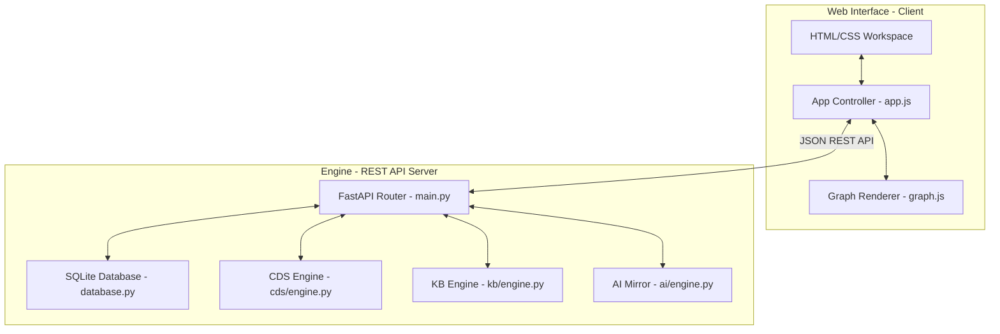
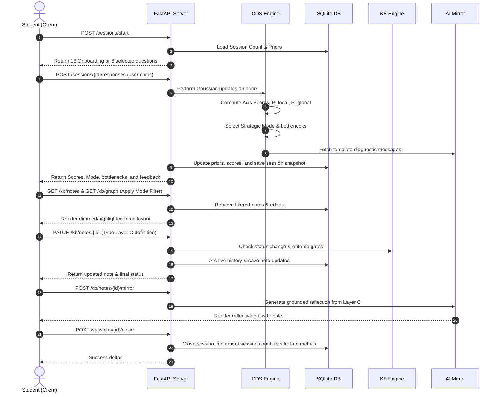

# System Architecture — KnowMe

This document describes the architectural design and structural organization of the KnowMe platform.

## System Topology

KnowMe is designed as a strict decoupled client-server architecture consisting of a Python-based FastAPI backend and a Vanilla HTML/CSS/JavaScript frontend. Communication occurs exclusively over a JSON REST API.

## System Modules

The backend consists of four primary directories in `/src/`:

1.  **FastAPI Router ([main.py](file:///home/mightyj/Desktop/Development/projects/Group/ICT_SUMMIT/src/main.py))**: Core server containing HTTP endpoint declarations, route controllers, validation, and JSON marshalling/unmarshalling.
2.  **Database Hub ([database.py](file:///home/mightyj/Desktop/Development/projects/Group/ICT_SUMMIT/src/database.py))**: Handles connection pooling, SQLite pragmas (including enforcing foreign key constraints), and table initialization.
3.  **CDS Engine ([cds/engine.py](file:///home/mightyj/Desktop/Development/projects/Group/ICT_SUMMIT/src/cds/engine.py))**: Contains mathematical modeling, Bayesian priors, Gaussian conjugate updates, proximity score calculations, and strategic mode criteria.
4.  **KB Graph Engine ([kb/engine.py](file:///home/mightyj/Desktop/Development/projects/Group/ICT_SUMMIT/src/kb/engine.py))**: Handles structural graph operations: auto-creating ghost notes, checking prerequisites, recalculating metrics, and merging duplicate notes.
5.  **AI Mirror Engine ([ai/engine.py](file:///home/mightyj/Desktop/Development/projects/Group/ICT_SUMMIT/src/ai/engine.py))**: Integrates with the Gemini API to construct grounded reflections, falling back to a custom rule-based keyword extraction mirror when offline.

## Data Flow Diagram

The lifecycle of a single study session follows a strict data pipeline:

